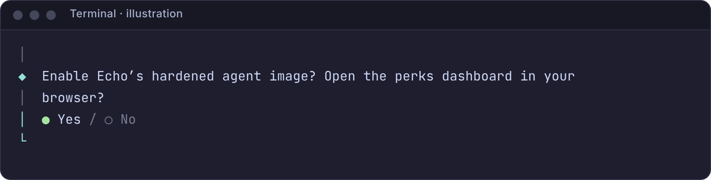
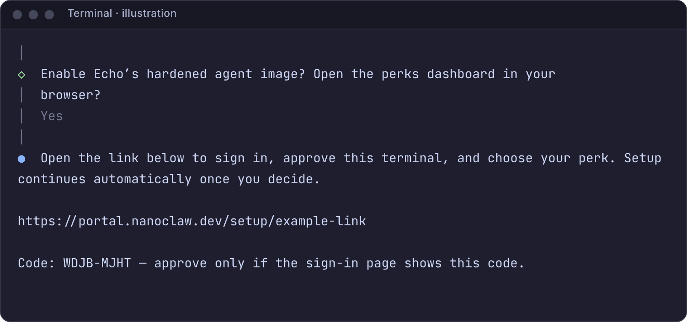
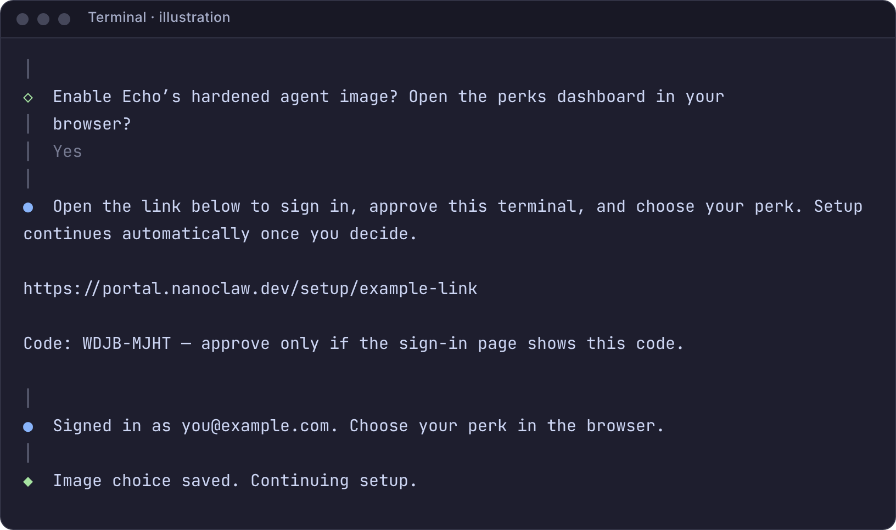

{/* verified-against: setup/auto.ts, setup/registry-login.ts, setup/registry-login.sh, setup/registry.ts, setup/lib/registry-state.ts, container/Dockerfile, container/build.sh, docs/hardened-image.md @ 639577c3 (main, #3150 merge); pins, pull checks, sign-in verification, and the pin gate: versions.json, container/pull.sh, setup/registry-login.ts, setup/registry.ts, setup/lib/registry-state.ts, setup/set-env.ts, setup/channels/slack-auto.ts, .github/workflows/verify-agent-image.yml @ 294ef2ae. Auth screenshots are production captures (authenticate.nanoclaw.dev, 2026-07-29); wizard default and pull checks: setup/auto.ts, container/pull.sh @ b76fcb3d */}
{/* verified-against (scoped correction): pin gate workflow: .github/workflows/verify-agent-image.yml @ 7203e00d (v2026.10.0) */}
{/* verified-against (scoped correction): per-release image lookup, pin gate covers agent-images.json, signature check blocks: container/pull.sh, container/release-image.sh, setup/lib/registry-state.ts, .github/workflows/verify-agent-image.yml (nanoclaw #4139) @ 61cf826d */}
{/* verified-against (scoped correction): fresh-install image question, portal link and code, and terminal illustrations: setup/portal.ts, setup/auto.ts @ 61cf826d */}

<Note>
  The hardened runtime is free and opt-in. Your existing local-build setup keeps working exactly as it does today. Choosing the hardened runtime is additive, not a replacement.
</Note>

## What the hardened runtime is

Every NanoClaw agent runs inside an isolated sandbox container. You can build that image locally from a public base — a 3–10 minute build that you own keeping patched. For supported Claude installs, the fresh-install wizard recommends fetching the hardened image instead.

The **Echo hardened runtime** replaces the local build with a pre-built, patched image. Through the NanoClaw and Echo partnership, Echo rebuilds the sandbox software from minimal components and keeps it patched on its own CVE cadence; NanoClaw delivers it from a gated registry, pinned by digest, so the bytes you run are exactly the bytes that were scanned. NanoClaw is the first open-source agent framework to offer its community a hardened agent environment.

The image bakes the sandbox's essential components:

- **Runtime and tools** — Node 22, Bun, pnpm, git, curl, unzip, and tini
- **Browser** — Chromium, with the fonts and libraries it needs
- **Agent layer** — the agent runner's dependencies and the bundled agent CLIs, including Claude Code

<Info>
  The pre-built image currently ships for the **Claude** provider. If you pick a different provider during setup, the installer builds the sandbox locally instead, and a group that later switches providers will prompt before leaving the pre-built image.
</Info>

## Why you would want it

- **Smaller attack surface.** Stripping the environment down to essential components takes the known-vulnerability count from thousands to near zero.
- **Patched for you.** Echo rebuilds the image on its own CVE cadence, so patch currency in layers you did not write — OS packages, Chromium, glibc — is no longer your job.
- **No local build.** Fetching swaps the 3–10 minute local build for a single download of roughly 800 MB — typically a few minutes, longer on distant or slow links (it's served from a single US region). Both paths stay available.
- **Zero cost.** The hardened runtime is free — authenticating with NanoClaw is all it takes. There is no paid tier.
- **Fully optional.** Building locally stays supported, unauthenticated, and untracked.

<Warning>
  The hardened runtime greatly reduces exposure to known vulnerabilities. It is not a guarantee against all risk, and no environment is fully immune from attack. Run it as one layer of a broader security posture — it does not replace [egress lockdown, mount allowlists, or resource limits](/operate/hardening), which contain what an agent can do at runtime.
</Warning>

## Prerequisites

- A machine that meets the standard NanoClaw [installation](/installation) requirements.
- A NanoClaw sign-in. You authenticate (or sign up) during setup; there is no separate paid plan to purchase.
- Agents on the Claude provider (see the note above).

Fetching the image requires authenticating with NanoClaw: your email address and the fact that you fetched an image are recorded. Building locally sends nothing.

## Enable it during a new install

Choose the hardened runtime while you set up NanoClaw for the first time.

<Steps>
  <Step title="Start the installer">
    Follow the standard [quick start](/quickstart) to clone the repository and launch the installer.

    ```bash
    git clone https://github.com/nanocoai/nanoclaw.git
    cd nanoclaw
    bash nanoclaw.sh
    ```
  </Step>
  <Step title="Say yes to the hardened image">
    The wizard asks **"Enable Echo’s hardened agent image? Open the perks dashboard in your browser?"** with **Yes** already selected. Press **Enter**. Answering **No** builds the sandbox on your machine instead.

    {/* Visual provenance: images/setup/portal-01-enable-prompt.png is an illustration, not a capture. Generated 2026-11-16 by scripts/setup-illustrations from the strings in setup/portal.ts @ 61cf826d, drawn by @clack/prompts 1.2.0. No installer was run. */}
    <Frame caption="Illustration, not a screenshot: the wizard's question, drawn from the current setup text.">
      
    </Frame>
  </Step>
  <Step title="Sign in and choose the perk in your browser">
    The terminal prints one link and a short code, and your browser opens on its own. If it doesn't, open the link on any device.

    {/* Visual provenance: images/setup/portal-02-link-and-code.png is an illustration, not a capture. Same generator and revision as above. The link, code, and email are placeholders. */}
    <Frame caption="Illustration, not a screenshot: the link to open and the code to compare. The link and code shown here are placeholders.">
      
    </Frame>

    The page asks you to sign in, or sign up:

    {/* Visual provenance: real production capture from 2026-07-29, taken before setup started opening the perks dashboard link. Not re-captured against the current flow; the page may look different. */}
    <Frame caption="Real capture from July 2026, before the perks dashboard was added. Sign in with email or a linked account.">
      
    </Frame>

    Then it shows the code back to you. Approve only if it matches the code in your terminal:

    <Frame caption="Real capture from July 2026. The browser confirms the code from your terminal.">
      
    </Frame>

    After you sign in, the terminal says **"Signed in as … Choose your perk in the browser."** and keeps waiting. Turn on the Echo hardened image in the dashboard. The terminal then shows **"Image choice saved. Continuing setup."**

    {/* Visual provenance: images/setup/portal-03-choice-saved.png is an illustration, not a capture. Same generator and revision as above. The perks dashboard itself is a hosted page and is not pictured. */}
    <Frame caption="Illustration, not a screenshot: what the terminal shows once you have signed in and chosen in the browser.">
      
    </Frame>

    If you skip the perk in the dashboard, or the sign-in doesn't finish, setup builds the sandbox locally instead. Nothing breaks, and you can [opt in later](#already-running-nanoclaw).
  </Step>
  <Step title="Finish the install">
    Let the installer finish. It pulls the image published for your release (listed in upstream `agent-images.json`), falling back to the `agent-image` pin in `versions.json`, always by digest, and checks the architecture and agent-runner lock label before tagging it as this install's sandbox image. Wrong architecture fails. A missing lock label fails unless you explicitly allow an unlabeled image; a mismatched label currently warns and continues, as described below.

    <Warning>
      The pull accepts a lockfile that does not match your checkout. This happens when your checkout's agent-runner lockfile differs from the one the image was built with, for example a checkout ahead of the newest release that has an image. The pull prints `Warning: agent-runner lock drift — tagging this image anyway.` and continues. Upstream marks this allowance temporary. If an agent then dies on a missing module, build locally with `./container/build.sh build`.
    </Warning>
  </Step>
</Steps>

## Already running NanoClaw?

The hardened runtime is additive, so existing installs are never switched over automatically. Opt in whenever you like, from your checkout:

```bash
bash setup/registry-login.sh   # same browser sign-in as above
./container/build.sh pull      # fetch the pinned image
```

To go back to building locally:

```bash
pnpm exec tsx setup/index.ts --step registry -- --opt-out
./container/build.sh build
```

## Prefer to build your own local runtime?

That path is fully supported and is not going anywhere. The local build is not deprecated, needs no account, and sends nothing to anyone. If you would rather build and manage the sandbox image yourself, keep doing exactly that. The hardened runtime is simply an additional option.

## Verify the hardened runtime is on

After setup, confirm what your agents are actually running:

```bash
pnpm exec tsx setup/index.ts --step registry
```

The status report shows:

- **Image source** — how this install gets its image: `pull a pinned image` or `build here`
- **On this machine** — what is actually present locally
- **Pinned** — the image reference this install tracks: `NANOCLAW_AGENT_IMAGE_REF` if set, else the image published for your release, else the `versions.json` pin
- **Signed in as** — the account, if any
- **Perks**: the entitlements on the account, listed only when it has any
- **Docker helper**: which registry hosts Docker asks NanoClaw for credentials on, or `not installed`

Provenance also rides in the image itself: the `dev.nanoclaw.image-source` label reads `hardened` for the pulled image, `local` for a local build, and `derived` for a per-group image extended on top of the pulled one.

## How a pin bump is gated

A repin is not merged on trust. A CI workflow gates both the `agent-image` pin in `versions.json` and `agent-images.json`, the list that maps each release to its hardened image. It re-checks every changed reference on the pull request, before the change can reach you, and finishes at once when neither file changed.

Five checks block the merge:

1. The reference must be digest-pinned. A mutable tag fails.
2. The image must be a multi-architecture index covering `linux/amd64` and `linux/arm64`.
3. The `dev.nanoclaw.agent-runner-lock-sha256` label must equal the agent-runner lockfile hash of the release the image is listed for, or of the branch for a pin that is not a listed release image. An image listed for a release must also carry that release's version and commit in its OCI labels.
4. The `dev.nanoclaw.image-source` label must read `hardened`.
5. The publisher's keyless Sigstore signature must verify against the digest with `cosign verify`. An image with no verified signature fails the pull request.

A manifest whose size moves by more than threefold in either direction raises a warning rather than blocking.

Nothing in the workflow merges anything; a person merges every repin.

<Note>
  No attestation or SBOM is checked, because the publisher attaches none. The workflow verifies the image's shape and, when present, its signature.
</Note>

## Sign-in verification

Signing in stores a credential for the registry. Your install can re-check that credential against the account service.

An account service it cannot reach keeps the stored sign-in and carries on, so an offline machine still pulls its image. The message names the reason:

```text
Couldn't reach the account service (<reason>); keeping the stored sign-in.
```

Unreachable is broader than offline. Any response that is not `200`, `401`, or `403` lands there, including a gateway error. A caller that would rather refuse than proceed unchecked passes `--require-verified`, which exits `2` instead of `0`. Nothing on the image path passes it today.

<Note>
  Signing in for Slack no longer decides your image source for you. That flow signs in through the same script, then puts the image question back: a deliberate local-build choice is restored, and an install that was never asked goes back to unasked. A plain `bash setup/registry-login.sh` still selects the hardened image.
</Note>

## Troubleshooting and FAQ

<AccordionGroup>
  <Accordion title="Is the hardened runtime really free?">
    Yes. The hardened runtime is free and opt-in — authentication is all it takes. There is no paid tier to unlock it.
  </Accordion>

  <Accordion title="Do I have to use it?">
    No. The local build stays fully supported. The hardened runtime is an additional option, not a requirement, and existing installs are not changed unless you opt in.
  </Accordion>

  <Accordion title="Does this make my agents impossible to attack?">
    No. The hardened runtime reduces exposure to known vulnerabilities by stripping the environment down to essential components. It does not remove all risk, and no environment is fully immune from attack. Runtime containment — [egress lockdown, mount allowlists, resource limits](/operate/hardening) — still does the heavy lifting.
  </Accordion>

  <Accordion title="What software is included?">
    The essential components of the sandbox:

    - **Runtime and tools** — Node 22, Bun, pnpm, git, curl, unzip, and tini
    - **Browser** — Chromium, with the fonts and libraries it needs
    - **Agent layer** — the agent runner's dependencies and the bundled agent CLIs, including Claude Code
  </Accordion>

  <Accordion title="Who keeps it patched?">
    Echo rebuilds and patches the image on its own CVE cadence — Echo's own agents research newly disclosed vulnerabilities, build fixes, run compatibility testing, and open pull requests for human review before anything ships. NanoClaw pins the result by digest and serves it from a gated registry.
  </Accordion>

  <Accordion title="Does it work with providers other than Claude?">
    Not yet. The pre-built image bundles the Claude tooling; installs on other providers build the sandbox locally, and switching a group to another provider prompts before leaving the pre-built image.
  </Accordion>

  <Accordion title="Can I still add packages to a group?">
    Yes. `install_packages` keeps working — it builds a small per-group image on top of the pulled one. That group's image then reports `derived` instead of `hardened`, since the vendor's scan covered the base, not your additions.
  </Accordion>

  <Accordion title="What gets recorded when I use it?">
    Your verified email address and the fact and time that you fetched an image. If — and only if — you consent to security and project updates during sign-up, that consent is recorded too — the [NanoClaw privacy policy](https://nanoclaw.dev/privacy) covers what happens to your address. Building locally is unauthenticated and sends nothing.
  </Accordion>

  <Accordion title="I already run NanoClaw. How do I switch?">
    Run `bash setup/registry-login.sh` from your checkout, sign in, then `./container/build.sh pull`. Your install is never switched automatically.
  </Accordion>
</AccordionGroup>

## Learn more

NanoClaw is open source and available at [github.com/nanocoai/nanoclaw](https://github.com/nanocoai/nanoclaw).

<CardGroup cols={2}>
  <Card title="Hardening" icon="shield-check" href="/operate/hardening">
    Runtime containment: egress lockdown, mount allowlists, and limits.
  </Card>

  <Card title="Security model" icon="shield" href="/concepts/security">
    How NanoClaw isolates and protects your agents.
  </Card>
</CardGroup>
